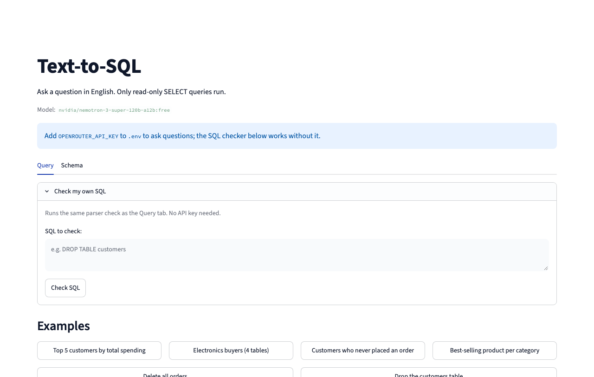

# Text-to-SQL

Natural-language-to-SQL generation with **two-layer defense-in-depth execution security**.

Translating natural language into SQL introduces serious security risks: a model might generate queries that mutate, drop, or exfiltrate database data, attempt memory exhaustion, or call malicious functions. This project ensures that untrusted model-generated SQL is rigorously validated and executed strictly within a hardened SQLite sandbox.



## Architecture & Defense-in-Depth

Untrusted generated SQL must pass through two independent security layers before and during execution:

```
User Question
    │
    ▼
LLM Generation (OpenRouter Nemotron / Custom Model)
    │
    ▼ [Untrusted SQL String]
┌─────────────────────────────────────────────────────────────┐
│ Layer 1: Pre-Execution AST Guardrails (SQLGlot)             │
│ • Exactly 1 statement (no stacked queries or chained DDL)   │
│ • Root allowlist: SELECT, UNION, INTERSECT, EXCEPT only     │
│ • Strict forbidden AST types: DML, DDL, PRAGMA, ATTACH, etc.│
│ • Function allowlist: safe scalar math, text, date, JSON    │
│ • Rejects load_extension, readfile, writefile, randomblob   │
│ • Table allowlist with lexical CTE scope verification       │
│ • Rejects cross-db qualifiers (e.g. temp.orders)            │
└──────────────────────────────┬──────────────────────────────┘
                               │ ALLOW
                               ▼
┌─────────────────────────────────────────────────────────────┐
│ Layer 2: Hardened SQLite Runtime Sandbox (SQLite C Engine)  │
│ • URI read-only connection: ?mode=ro                        │
│ • Query lock: PRAGMA query_only = ON                        │
│ • C-level Limits:                                           │
│     - SQLITE_LIMIT_ATTACHED = 0 (blocks attaching DBs)      │
│     - SQLITE_LIMIT_LENGTH = 1 MB (blocks memory exhaustion) │
│     - SQLITE_LIMIT_SQL_LENGTH = 20 KB                       │
│ • SQLite Authorizer callback (set_authorizer):              │
│     - Hardware-like gate at bytecode compilation            │
│     - Permits only SELECT & reading schema tables / CTEs    │
│     - Forbids sqlite_master, unlisted tables & TVFs         │
│     - Forbids functions outside the safe allowlist          │
│ • Wall-clock deadline: 3.0s limit (set_progress_handler)    │
│ • Result caps: max 1,000 rows & 10 MB payload data budget   │
└──────────────────────────────┬──────────────────────────────┘
                               │
                               ▼
                        Safe Query Result
```

## Quick Start (macOS / Linux / Windows)

Requires Python 3.12 and [uv](https://github.com/astral-sh/uv).

```bash
# 1. Clone repository
git clone https://github.com/Krish3101/text-to-sql.git
cd text-to-sql

# 2. Pin Python 3.12 and synchronize dependencies
uv python pin 3.12
uv sync

# 3. Configure environment (Optional: only needed for LLM questions)
cp .env.example .env
# Add your free OpenRouter API key to .env if you wish to run natural language questions.
# "Check my own SQL" and all security tests run completely offline without an API key!

# 4. Launch Streamlit Application
uv run streamlit run app.py
```

The database (`ecommerce.db`) is automatically built from `schema.sql` and `seed.sql` on the first run.

## Security Test Matrix

Run the comprehensive regression and attack suite:

```bash
uv run pytest -v
```

The test suite validates:
- **46+ categorized attack vectors in `attacks.yaml`** (DDL, DML, ATTACH, VACUUM, PRAGMAs, memory exhaustion bombs, forbidden functions, table-valued functions, stacked statements).
- **Direct Layer 2 Sandbox Isolation**: attacks executed directly against `connect_ro()` bypassing the AST layer are stopped by the SQLite authorizer, raising errors, creating 0 files, and maintaining identical database fingerprints.
- **Lexical CTE Scoping**: CTE aliases defined in subqueries cannot be referenced in outer queries.
- **Resource Limits**: Infinite recursive CTEs are terminated at 3.0 seconds; results exceeding 1,000 rows or 10 MB are safely truncated.

## Linting & Formatting

```bash
uv run ruff check .
uv run ruff format --check .
```

## Accuracy Evaluation

To test accuracy against the 20-question evaluation benchmark with an OpenRouter API key:

```bash
uv run python -m scripts.eval
```

## Core Modules

| Module | File | Responsibility |
| :--- | :--- | :--- |
| **User Interface** | `app.py` | Streamlit UI with Query & Schema tabs and offline SQL checker |
| **Orchestrator** | `src/text_to_sql/engine.py` | Pipeline coordinator: prompt -> LLM -> guardrails -> compile test -> execution |
| **AST Guardrails** | `src/text_to_sql/guardrails.py` | SQLGlot AST inspection, function allowlisting, CTE scoping |
| **Executor Sandbox** | `src/text_to_sql/executor.py` | Hardened read-only SQLite execution with authorizer, limits, and timeout |
| **Schema Engine** | `src/text_to_sql/schema.py` | Dynamic schema and data notes introspection |
| **LLM Client** | `src/text_to_sql/llm.py` | Lightweight zero-dependency OpenRouter HTTP client (`urllib.request`) |
| **Database Builder**| `src/text_to_sql/database.py` | Atomic database initialization and integrity checks |
| **Configuration** | `src/text_to_sql/config.py` | Application constants, resource limits, and model configuration |

## License

MIT
